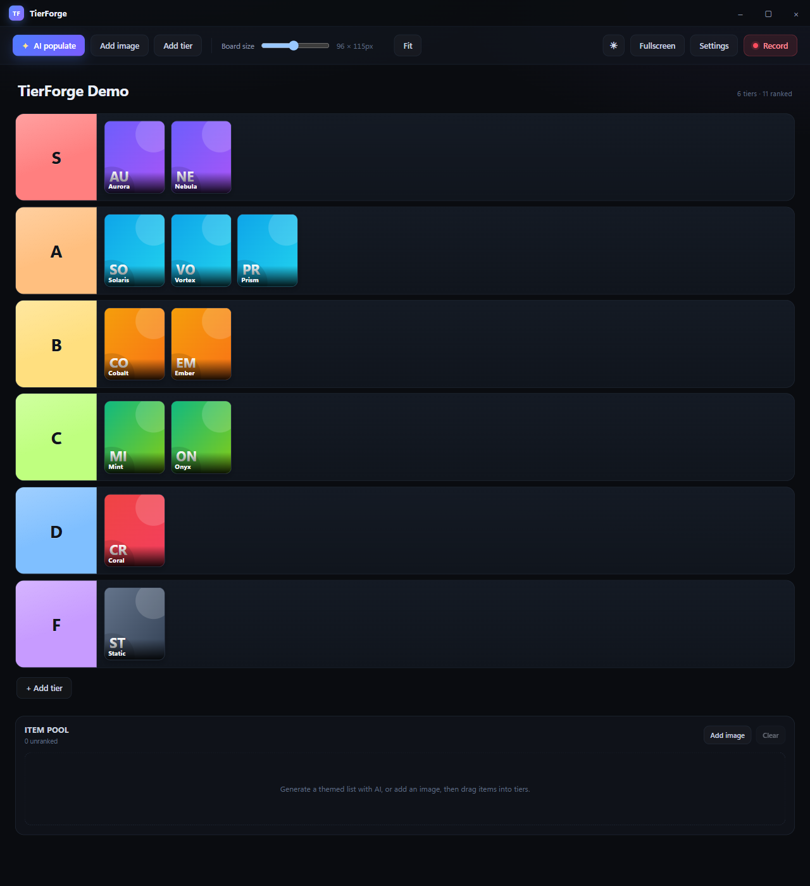
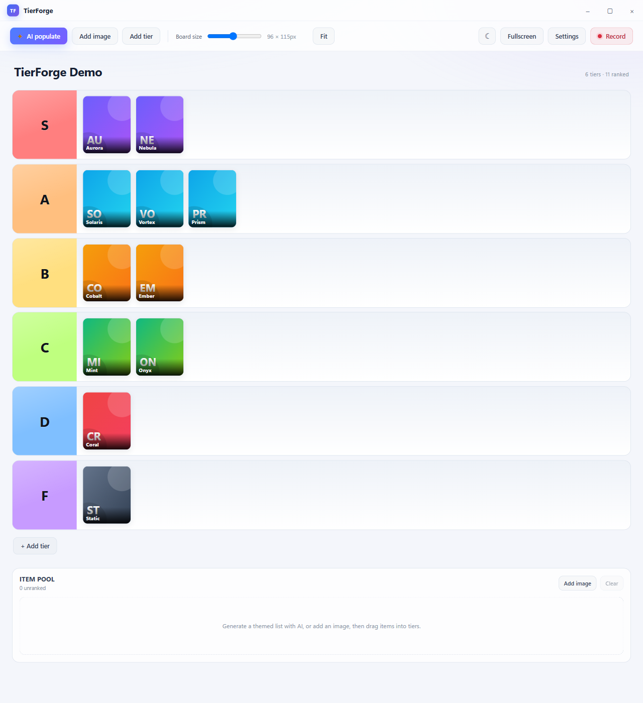
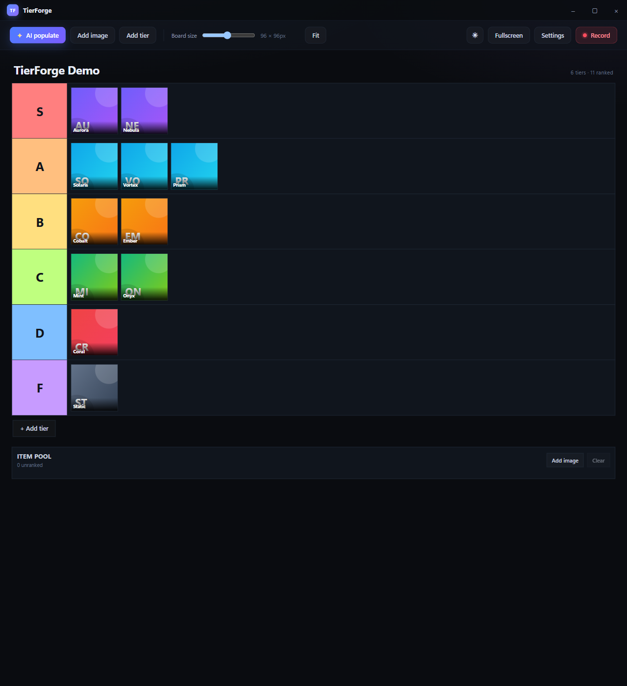
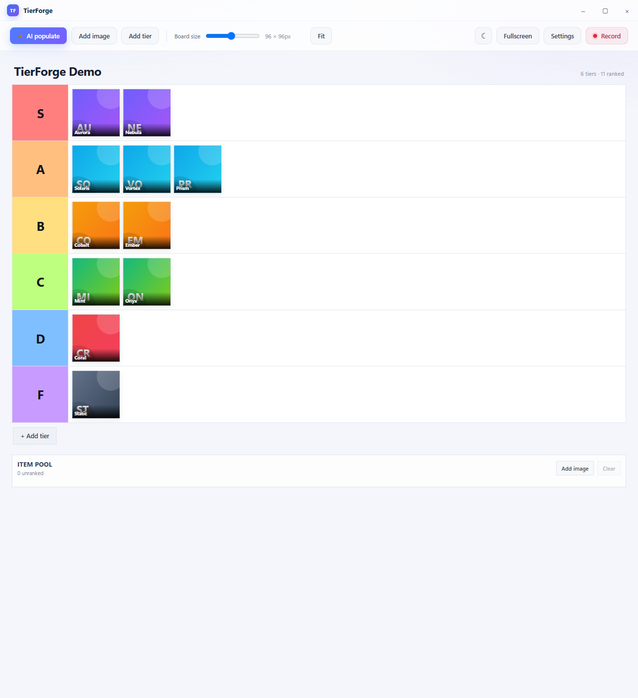
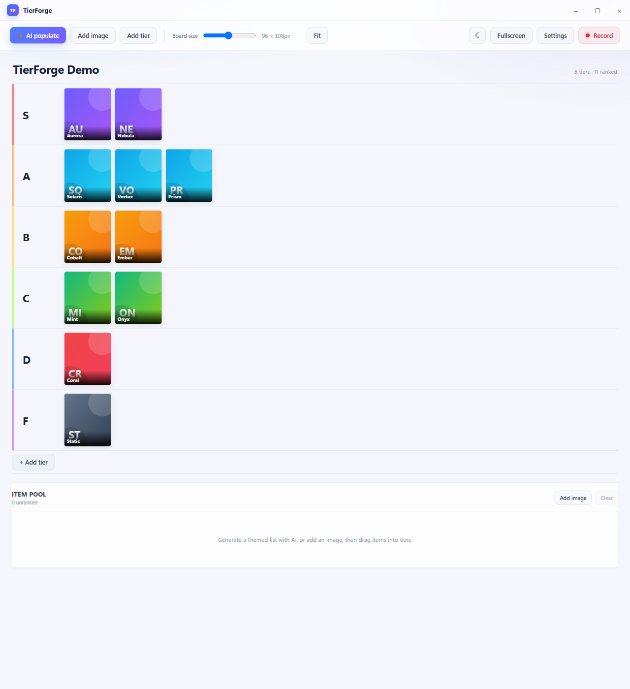
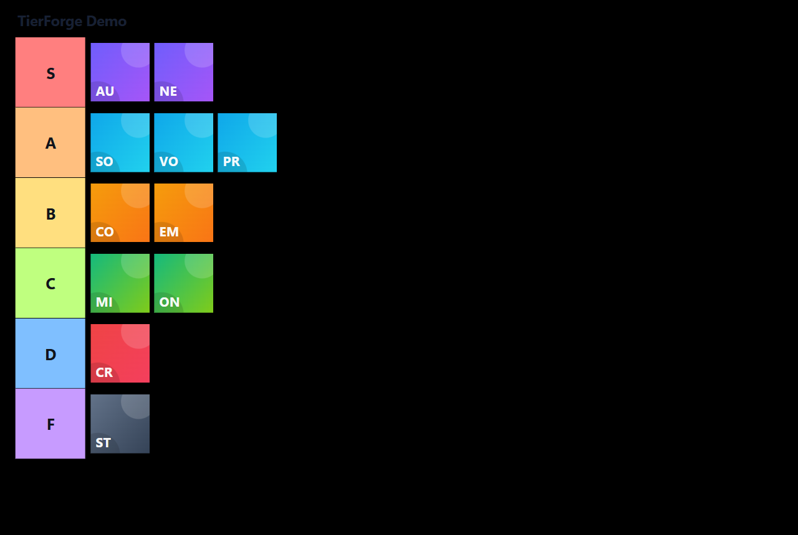
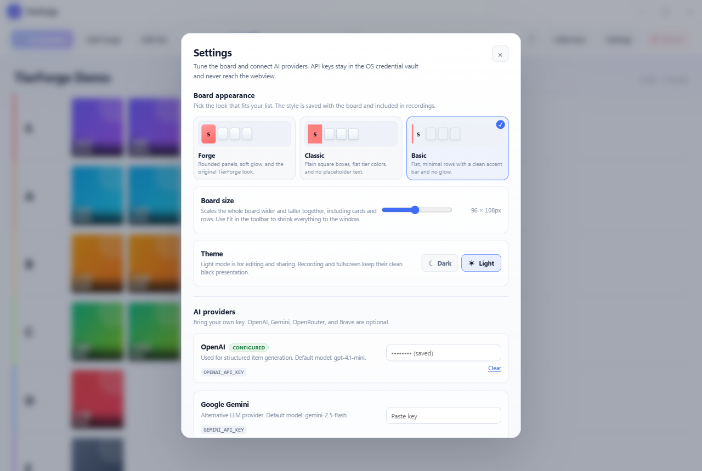
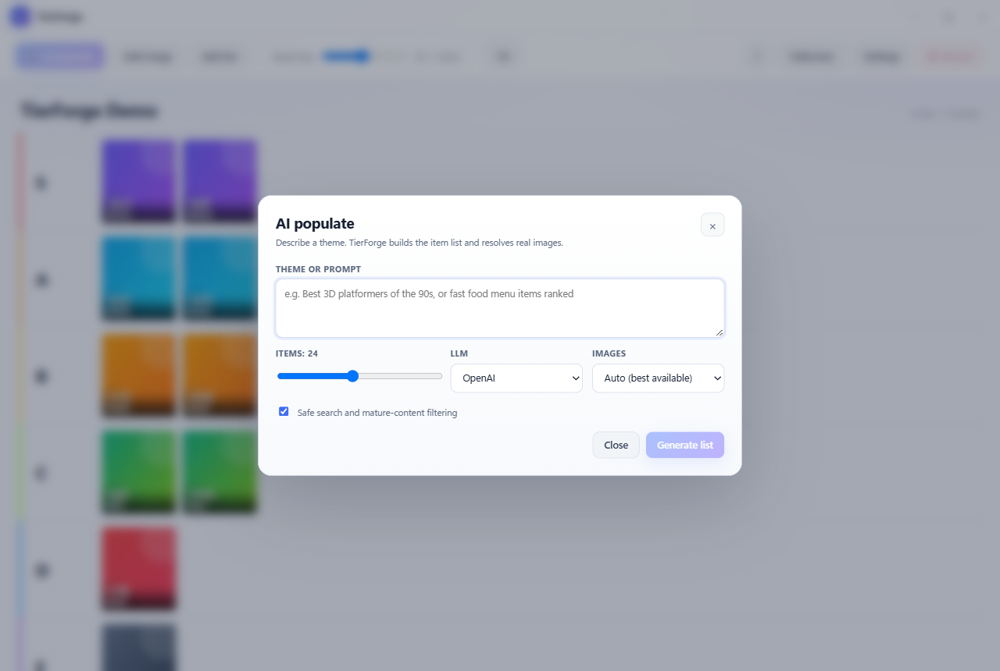

# TierForge

A desktop tier-list studio built with **Rust + Tauri v2**, **React 19**, and **Vite 7**.

TierForge turns a prompt into a themed tier list, resolves real images for every
item, lets you drag them across S/A/B/C/D/F rows, and records a clean H.264 MP4
of **only the board's client area** — no OS title bar, no window buttons, no
taskbar, no recording HUD.

---

## Download

Windows 10/11 x64 builds are available on the
[Releases page](https://github.com/Arch087146/tier-forge/releases):

- `TierForge_*_x64-setup.exe` — NSIS installer (recommended)
- `TierForge_*_x64_en-US.msi` — MSI installer
- `TierForge_*_x64-portable.zip` — portable build

See the [code signing policy](CODE_SIGNING.md) for signing status and
verification steps.

---

## Screenshots

Screenshots use a demo board with inline SVG tiles so the repository stays
self-contained. No video files are included.

| Forge · dark | Forge · light |
| --- | --- |
|  |  |

| Classic · dark | Classic · light |
| --- | --- |
|  |  |

| Basic · light | Fullscreen presentation |
| --- | --- |
|  |  |

| Settings | AI populate |
| --- | --- |
|  |  |

---

## What is in the box

| Module | What it does |
| --- | --- |
| **AI auto-populator** | Sends the theme to OpenAI, Gemini, or OpenRouter, gets back item names + image search queries, then resolves real images through Openverse, Brave Image Search, and Wikimedia Commons. Images are validated, resized, converted to JPEG, and cached locally. |
| **Tier board** | Six default tiers (S–F), editable names and colors, one board-size slider that scales the whole board wider and taller together (the readout shows the resulting card dimensions), three board styles (Forge, Classic, Basic), a dark/light theme toggle, and a one-click **Fit** command that finds the largest board size that fits both the window's width and height (it also grows a board that was left smaller than the available space). Add/remove tiers, multi-container drag-and-drop powered by `@dnd-kit` (including a fixed **return to item pool** target that stays reachable while a tier is scrolled), persisted to `localStorage` with Zustand. Fullscreen hides the editing chrome and auto-reveals the full toolbar at the top edge. |
| **Client-area recorder** | Windows Graphics Capture (`windows-capture` 2.0.1) captures the Tauri window, which is borderless (`decorations: false`). The in-app titlebar and toolbar are hidden during capture, and a separate always-on-top HUD window holds the Stop button. Output is H.264 in an MP4 container, encoded by Media Foundation. |

---

## Architecture

```
┌──────────────────────────────────────────────────────────────────┐
│ Tauri window "main"  (decorations: false, 1280×860)              │
│                                                                  │
│  React 19 + Vite 7                                               │
│  ┌────────────────────────────────────────────────────────────┐  │
│  │ TitleBar (hidden while recording)                          │  │
│  │ Toolbar  (hidden while recording)                          │  │
│  │ ┌────────────────────────────────────────────────────────┐ │  │
│  │ │ Board (the captured surface)                           │ │  │
│  │ │  S / A / B / C / D / F rows + unranked pool            │ │  │
│  │ └────────────────────────────────────────────────────────┘ │  │
│  └────────────────────────────────────────────────────────────┘  │
└───────────────────────────────┬──────────────────────────────────┘
                                │ invoke()
┌───────────────────────────────▼──────────────────────────────────┐
│ Rust backend (src-tauri)                                         │
│                                                                  │
│  commands.rs ──► ai/        OpenAI / Gemini / OpenRouter output   │
│              └─► images/    search → download → validate → cache │
│              └─► recorder/  WGC window capture + MF encoder      │
│                                                                  │
│  AppState: reqwest client, cache dir, video dir, cancellation,   │
│            live RecordingSession                                 │
└───────────────────────────────┬──────────────────────────────────┘
                                │ Windows Graphics Capture
┌───────────────────────────────▼──────────────────────────────────┐
│ H.264 / MP4 in the user's Videos/TierForge folder                │
└──────────────────────────────────────────────────────────────────┘

Separate top-level window "recorder" (300×64, always-on-top, skipTaskbar,
transparent) shows the timer and Stop button. It is never part of the captured
window, so the controls cannot appear in the video.
```

### Why the recording is clean

1. `tauri.conf.json` sets `"decorations": false` and `"shadow": false` for the
   main window. Tauri therefore never draws an OS title bar or window buttons,
   and Windows does not add the 1px DWM border that `shadow: true` creates for
   undecorated windows.
2. The app draws its own HTML titlebar and toolbar. During recording the
   `recording` class hides both, so the board fills the whole client area.
3. The Rust command verifies `Window::title_bar_height(hwnd) == 0` before
   starting capture and refuses to record otherwise. This is a hard invariant,
   not a visual assumption.
4. WGC captures the window, not the monitor. The taskbar and other windows are
   outside the capture item. `DrawBorderSettings::WithoutBorder` prevents the
   capture API from drawing its own yellow border.
5. The Stop button lives in a separate `recorder` window, so it is outside the
   captured window's surface.

### Fullscreen presentation

Press **F11** or click **Fullscreen** in the toolbar to enter native fullscreen.
The titlebar disappears, the toolbar auto-hides, the app background turns black,
and the board keeps only its tier content and item images. The board footer,
pool actions, item names, delete buttons, and empty-state hints are hidden.
Classic and Basic both collapse to a flat black canvas in this mode. The
dark/light theme is an editing preference only; fullscreen and recording always
use the clean black presentation.

Move the pointer to the very top edge to reveal the full toolbar, including AI
populate, Add image, Add tier, the size slider, Fit, Settings, Record, and Exit
fullscreen; moving away hides it again after ~320 ms. **Esc** or **F11** also
exits. The same black canvas and hidden chrome are used while recording, so a
recording made in fullscreen stays clean.

---

## Project layout

```
tier-forge/
├─ index.html                  main window entry
├─ recorder.html               HUD window entry
├─ package.json
├─ vite.config.ts              multi-page build (main + recorder)
├─ tsconfig.json
├─ .env.example
├─ src/
│  ├─ App.tsx                  app shell, recorder orchestration, toasts
│  ├─ main.tsx
│  ├─ recorder.tsx             HUD entry
│  ├─ styles.css               dark design system, recording mode
│  ├─ types.ts                 shared payload types
│  ├─ lib/tauri.ts             typed invoke wrappers
│  ├─ store/board.ts           Zustand board + multi-container move logic
│  └─ components/
│     ├─ TitleBar.tsx          custom drag region + window controls
│     ├─ Toolbar.tsx           AI, add image, add tier, size, Fit, record
│     ├─ Board.tsx             DndContext + tier rows + pool
│     ├─ TierRow.tsx           droppable row, editable label/color
│     ├─ ItemCard.tsx          sortable image card
│     ├─ Pool.tsx              unranked droppable pool
│     ├─ AiDialog.tsx          prompt, count, provider, progress
│     ├─ SettingsDialog.tsx    board style, size, API keys (never sent to webview)
│     └─ RecorderHud.tsx       timer + Stop button
└─ src-tauri/
   ├─ Cargo.toml
   ├─ build.rs
   ├─ tauri.conf.json
   ├─ capabilities/default.json
   ├─ icons/
   └─ src/
      ├─ main.rs
      ├─ lib.rs                 plugins, state, command registration
      ├─ error.rs               serializable AppError
      ├─ state.rs               AppState + RecordingSession
      ├─ commands.rs            all #[tauri::command] entry points
      ├─ ai/
      │  ├─ mod.rs              prompt, normalization, progress, keyring
      │  └─ providers.rs        OpenAI + Gemini + OpenRouter generation
      ├─ images/
      │  ├─ mod.rs              provider chain + candidate validation
      │  ├─ providers.rs        Openverse / Brave / Wikimedia
      │  └─ cache.rs            download limits, thumbnail, JPEG, SHA-256
      └─ recorder/
         ├─ mod.rs              start/stop/status, HUD placement
         └─ win.rs              WGC handler + H.264 encoder
```

---

## Prerequisites

- **Windows 10 2004+ or Windows 11** (the recorder uses Windows Graphics
  Capture; the rest of the app is portable).
- **Rust 1.85+** with the MSVC toolchain (`rustup default stable-x86_64-pc-windows-msvc`).
- **Node.js 20+** and npm.
- **Visual Studio Build Tools** with the "Desktop development with C++"
  workload (MSVC linker + Windows SDK).
- **WebView2 runtime** (preinstalled on Windows 11; the Tauri installer can
  bootstrap it on Windows 10).

On macOS/Linux the board and AI features compile and run, but the native
recorder returns a clear "Windows-only" error. Use the Windows build for
recording.

---

## Quick start

```powershell
cd C:\Users\emara\tier-forge

# 1. Frontend dependencies
npm install

# 2. Run the desktop app in development
npm run desktop
```

`npm run desktop` starts Vite on port 1420 and launches the Tauri shell with
hot reload for the React code. Rust changes trigger a Tauri rebuild.

### Production bundle

```powershell
npm run bundle
```

Installers are written to `src-tauri/target/release/bundle/`. The `bundle`
script uses Tauri's default targets (`nsis` and `msi` on Windows).

### Frontend-only preview

```powershell
npm run dev      # Vite on http://localhost:1420
npm run build    # type-check + production assets in dist/
```

The frontend detects `__TAURI_INTERNALS__`; outside Tauri the board, drag-and-drop,
and localStorage persistence work in a normal browser, while AI/recorder/import
commands are unavailable. `TitleBar` and the event listeners guard on this flag,
so the Vite preview does not crash.

---

## API keys

Open **Settings** in the app and paste keys. They are written to the OS
credential vault through the `keyring` crate:

- Windows Credential Manager
- macOS Keychain

Keys are read only inside Rust and are **never** returned to the webview. The
frontend only receives a boolean from `has_api_key`.

| Provider | Key | Required for |
| --- | --- | --- |
| OpenAI | `OPENAI_API_KEY` | LLM item generation (default model `gpt-4.1-mini`) |
| Google Gemini | `GEMINI_API_KEY` | Alternative LLM (`gemini-2.5-flash`) |
| OpenRouter | `OPENROUTER_API_KEY` | One key for many models (default `openai/gpt-4.1-mini`) |
| Brave Search | `BRAVE_API_KEY` | Higher-quality image search (optional) |

For development you can skip Settings and set the same variables in your shell
or in a `.env` file loaded by your terminal. Environment variables take
priority over the credential vault.

Image search works without any key through **Openverse** and **Wikimedia
Commons**. Brave is tried only when a key is configured.

> Linux note: the keyring backend is intentionally Windows/macOS-only in this
> build. Use environment variables on Linux, or add
> `sync-secret-service`/`crypto-rust` features to the `keyring` dependency.

---

## AI pipeline

1. The prompt and item count are sent to the selected LLM. OpenAI uses
   `response_format: json_schema`; Gemini uses `responseSchema` +
   `responseMimeType`; OpenRouter uses the OpenAI-compatible chat endpoint with
   an explicit JSON instruction so any model in its catalogue can be used.
2. The model returns `{ items: [{ name, search_query, description }] }`.
   It is explicitly instructed **not** to invent image URLs.
3. Names are trimmed, deduplicated case-insensitively, and capped at the
   requested count.
4. Up to five items are resolved concurrently. For each item, providers are
   tried in order:
   - **Openverse** — CC-licensed images, commercial/modification allowed,
     mature results excluded.
   - **Brave Images** — only when `BRAVE_API_KEY` is present; safe-search is
     strict by default.
   - **Wikimedia Commons** — `generator=search`, namespace 6, 900px thumbs.
5. Each candidate image is downloaded with a 15 MB cap, decoded, thumbnailed to
   a 768px maximum edge, composited over white, and encoded as JPEG quality 82.
   Files are named by the SHA-256 of the source URL, so repeats are free.
6. The frontend receives the local cache path plus attribution
   (`pageUrl`, `author`, `license`). `convertFileSrc` serves the file through
   Tauri's asset protocol; the CSP allows `asset:` and `http://asset.localhost`.
7. Progress is emitted as `ai://progress` events with phase, done/total, and the
   latest resolved item. Cancel uses a `CancellationToken`.

Items whose image cannot be resolved are still returned, with `image: null`;
the board renders a styled initials placeholder instead.

---

## Recorder details

### Flow

1. Click **Record**. The frontend adds the `recording` class, waits for two
   animation frames plus 240 ms so the compositor presents a clean frame, then
   invokes `start_recording`.
2. Rust:
   - refuses if a recording is already active, the window is minimized, or the
     window is smaller than 320×240;
   - rounds width/height down to even numbers (H.264 requirement);
   - resolves the HWND via `HasWindowHandle` / `raw-window-handle`;
   - verifies `title_bar_height == 0`;
   - verifies `Window::is_valid()`;
   - creates the H.264 MP4 encoder (bitrate scaled to resolution and FPS);
   - starts `Recorder::start_free_threaded(settings)`;
   - freezes the window size (`set_resizable(false)`), shows the HUD, and
     stores the `CaptureControl::stop` closure in `AppState`.
3. A 2×2 pixel "capture ticker" alternates between two visually identical dark
   colors while recording. WGC only delivers frames when the window presents a
   new one; the ticker keeps the timeline continuous even when the board is
   static. `MinimumUpdateIntervalSettings::Custom` throttles capture to the
   requested FPS.
4. **Stop** (HUD button or `Ctrl+Shift+R`) invokes `stop_recording`. Rust takes
   the session, calls `CaptureControl::stop()` on a blocking worker, restores
   the window title/resizability, hides the HUD, and verifies the file is
   non-empty.
5. Output: `%USERPROFILE%\Videos\TierForge\tierforge-YYYYMMDD-HHMMSS-xxxxxx.mp4`.

### Why H.264 MP4

- `VideoSettingsSubType::H264` is set explicitly; the crate defaults to HEVC,
  which is poorly supported by browsers and many editors.
- `ContainerSettingsBuilder::default()` is MPEG-4 (`.mp4`).
- Audio is disabled (`AudioSettingsBuilder::default().disabled(true)`); this
  build records the board, not a microphone.
- `ColorFormat::Bgra8` matches the desktop compositor and the encoder's
  uncompressed input format.
- The encoder is created **before** the capture thread starts, so frame
  dimensions cannot race the encoder configuration.

### Recording rules

- Do **not** minimize the window while recording; WGC produces no frames for
  minimized windows.
- Do **not** move the window between monitors with different DPI scaling during
  a recording; the physical client size can change and the encoder expects a
  fixed size.
- The HUD is a separate always-on-top window. It is intentionally excluded from
  the capture.
- If you change `decorations` to `true`, recording is refused. That is by
  design.

---

## Commands and events

### Tauri commands

| Command | Payload | Returns |
| --- | --- | --- |
| `populate_board` | `{ req: GenerateRequest }` | `PopulateResult` |
| `cancel_populate` | — | `boolean` |
| `set_api_key` | `{ provider, key }` | `void` |
| `has_api_key` | `{ provider }` | `boolean` |
| `clear_api_key` | `{ provider }` | `void` |
| `import_image` | `{ path }` | `CachedImage` |
| `reveal_recording` | `{ path }` | `void` |
| `start_recording` | `{ req: { fps?, bitrate?, includeCursor? } }` | `RecordingStarted` |
| `stop_recording` | — | `RecordingResult` |
| `recording_status` | — | `RecordingStatus` |

### Events

| Event | Payload |
| --- | --- |
| `ai://progress` | `{ phase, done, total, item? }` |
| `recorder://state` | `{ recording: boolean, output?: string }` |
| `recorder://started` | `()` (capture thread is live) |
| `recorder://closed` | `()` (target window closed) |

---

## Data locations

| Data | Location |
| --- | --- |
| Image cache | `%LOCALAPPDATA%\com.tierforge.app\cache\images` (Tauri `app_cache_dir`) |
| Recordings | `%USERPROFILE%\Videos\TierForge` |
| Board state | WebView `localStorage`, key `tierforge.board.v1` |
| API keys | Windows Credential Manager / macOS Keychain, service `com.tierforge.app` |

The asset protocol scope is limited to `$APPCACHE/**` and `$APPLOCALDATA/**`.

---

## Security notes

- API keys never cross the IPC boundary back to JavaScript.
- The webview CSP restricts scripts to self (plus Vite's dev preamble via
  `devCsp`), images to self/asset/https/data/blob, and connections to IPC,
  the Vite dev server, and HTTPS APIs.
- The Rust HTTP client has connect and total timeouts, a 15 MB image download
  cap, and a 30 MB local import cap.
- `reveal_recording` only reveals a path; it does not execute it.
- Recording output is written to the user's Videos folder. The app does not
  upload it anywhere.

---

## Troubleshooting

**`npm run build` fails with "Cannot find name 'process'"**
Install the Node types: `npm install -D @types/node`. The included
`tsconfig.json` already lists `"node"` in `compilerOptions.types`.

**"Recording requires the borderless window mode"**
The main window in `tauri.conf.json` must keep `"decorations": false` and
`"shadow": false`. If you add OS decorations, the hard check refuses to capture
rather than silently including chrome. `shadow: true` on Windows adds a 1px
border to undecorated windows, which can also trip the check or appear in the
video.

**"The window is not capturable yet"**
Make sure the main window is visible and not minimized. WGC's `is_valid()`
rejects hidden, tool, and child windows.

**The MP4 is only a few frames long**
The capture ticker should prevent this. If you remove it, WGC only delivers
frames when the board changes, so pauses are compressed. Keep the ticker
mounted while recording.

**The MP4 will not play in a browser**
Confirm the output is H.264 (not HEVC). The code sets
`VideoSettingsSubType::H264` explicitly. Hardware encoders vary; if Media
Foundation has no H.264 encoder, try a machine with a GPU driver that exposes
one, or install the "Media Feature Pack" on Windows N editions.

**Images do not appear**
Check that the asset protocol is enabled and that the cache path is inside
`$APPCACHE/**`. The frontend uses `convertFileSrc`; a plain `file://` URL will
be blocked by the webview.

**Openverse returns 403/429**
Openverse rate-limits anonymous traffic. The resolver falls back to Wikimedia
Commons, and adding a Brave key gives a third path. Cached images are reused.

**AI returns no items**
The LLM may have refused the theme or returned malformed JSON. The error box
shows the upstream message. Try a more specific prompt, or switch providers.

---

## Design decisions and trade-offs

- **No Tailwind.** The UI is a small, hand-written CSS design system. It keeps
  the bundle lean and makes the recording-mode overrides explicit.
- **LLM does not return image URLs.** Generated URLs are usually broken or
  hallucinated. The model returns search queries; the Rust side resolves real,
  licensed images and records attribution.
- **Separate HUD window.** Putting Stop inside the main window would either be
  captured or require cropping a region out of every frame. A separate window
  is simpler and exact.
- **WGC window capture, not monitor capture.** Window capture is inherently
  limited to the app's client area, so the taskbar and other windows cannot
  leak in.
- **`decorations: false` + HTML titlebar.** This is what makes the "no OS
  chrome" guarantee possible. The HTML chrome is hidden during recording.
- **Zustand persistence.** Board edits survive restarts without a database.
  Images live on disk; the persisted state stores only URLs and metadata.

---

## Code signing policy

**Free code signing provided by [SignPath.io](https://signpath.io), certificate by [SignPath Foundation](https://signpath.org).**

- Committers and reviewers: [Adam Emara (@Arch087146)](https://github.com/Arch087146)
- Approvers: [Adam Emara (@Arch087146)](https://github.com/Arch087146)
- Privacy policy: [PRIVACY.md](PRIVACY.md)

Only artifacts built by the public
[release workflow](.github/workflows/release.yml) from this repository are
submitted for signing. The signed assets are `TierForge.exe`, the NSIS setup
executable, and the MSI installer. See [CODE_SIGNING.md](CODE_SIGNING.md) for
the full policy and verification steps.

## License

MIT. Third-party image results retain their own licenses; TierForge stores and
surfaces the attribution returned by the image providers.
