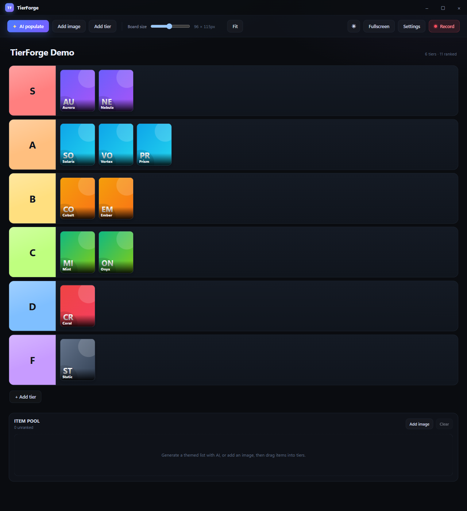

# TierForge v0.1.0

First public release of TierForge — a Rust + Tauri v2 desktop tier-list studio.



## Highlights

- **AI auto-population** — describe a theme, pick OpenAI, Gemini, or OpenRouter, and get a full tier list with real, locally cached images resolved through Openverse, Brave Image Search, and Wikimedia Commons.
- **Drag-and-drop tier board** — six editable S–F rows plus an item pool, with a persistent return-to-pool target, tier renaming and color picking, and Zustand persistence.
- **Three board styles** — Forge, Classic, and Basic, each with dark and light themes.
- **Proportional board sizing** — one slider scales the whole board wider and taller together; **Fit** finds the largest size that fits both the window width and height.
- **Fullscreen presentation** — chrome-free black canvas with an auto-revealing toolbar at the top edge.
- **Clean client-area recording** — Windows Graphics Capture writes H.264 MP4 of only the board surface, with no title bar, taskbar, or recording HUD in frame.

## Downloads

| Asset | Description |
| --- | --- |
| `TierForge_0.1.0_x64-setup.exe` | NSIS installer (recommended) |
| `TierForge_0.1.0_x64_en-US.msi` | MSI installer for managed deployment |
| `TierForge_0.1.0_x64-portable.zip` | Portable build — unzip and run `TierForge.exe` |
| `SHA256SUMS.txt` | SHA-256 checksums for every asset |

## Requirements

- Windows 10 version 2004+ or Windows 11, x64.
- WebView2 runtime. Windows 11 includes it; the installers bootstrap it on Windows 10 if needed.
- The portable build assumes WebView2 is already installed.

## Install

1. Download `TierForge_0.1.0_x64-setup.exe` (or the MSI).
2. Because this build is not code-signed, Windows SmartScreen may show a warning. Choose **More info → Run anyway**.
3. Launch TierForge, open **Settings**, and add an OpenAI, Gemini, or OpenRouter key to use AI population. Keys are stored in Windows Credential Manager and never returned to the frontend.

Image search works without a key through Openverse and Wikimedia Commons. A Brave Search key is optional.

## Notes

- The native recorder is Windows-only. The board and AI features are cross-platform in source, but this release ships Windows binaries only.
- Recordings are written to `%USERPROFILE%\Videos\TierForge`.
- This is an unsigned `0.1.0` build; expect SmartScreen warnings.

## Verification

```powershell
Get-FileHash .\TierForge_0.1.0_x64-setup.exe -Algorithm SHA256
```

Compare the output with `SHA256SUMS.txt`.

Full documentation: https://github.com/Arch087146/tier-forge#readme
